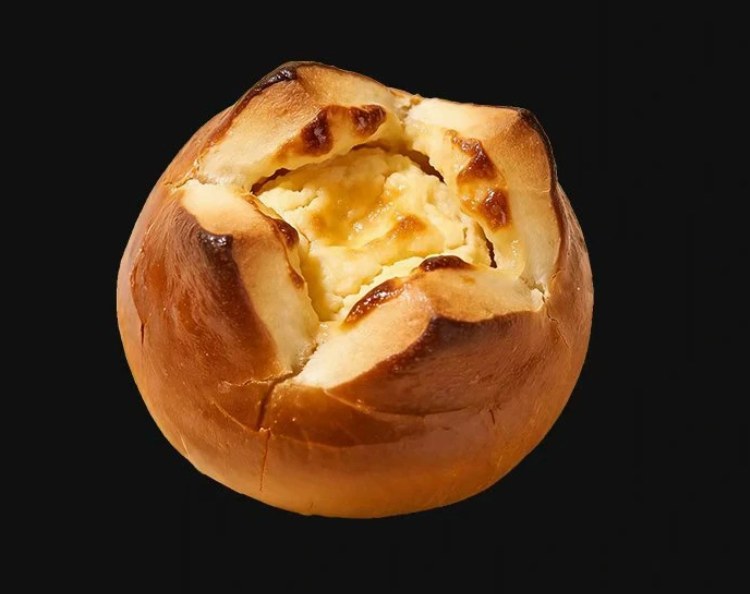
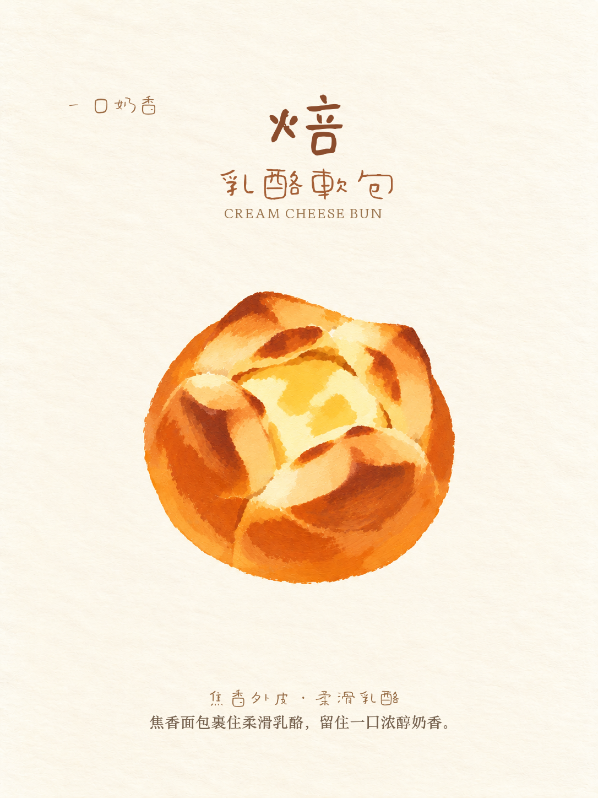
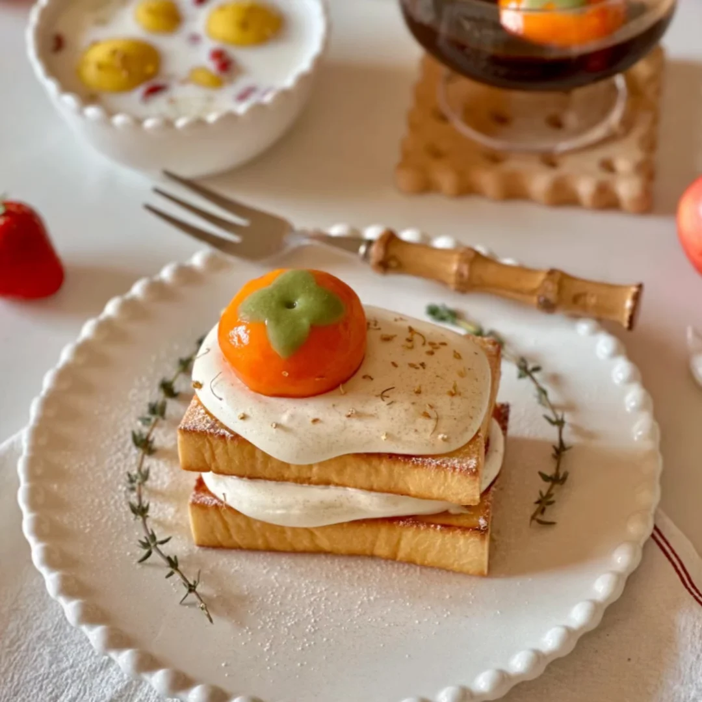
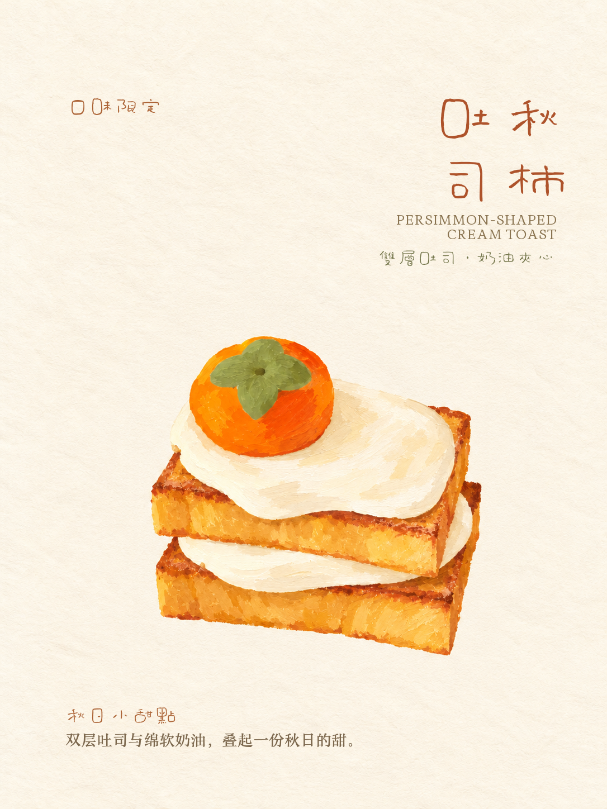
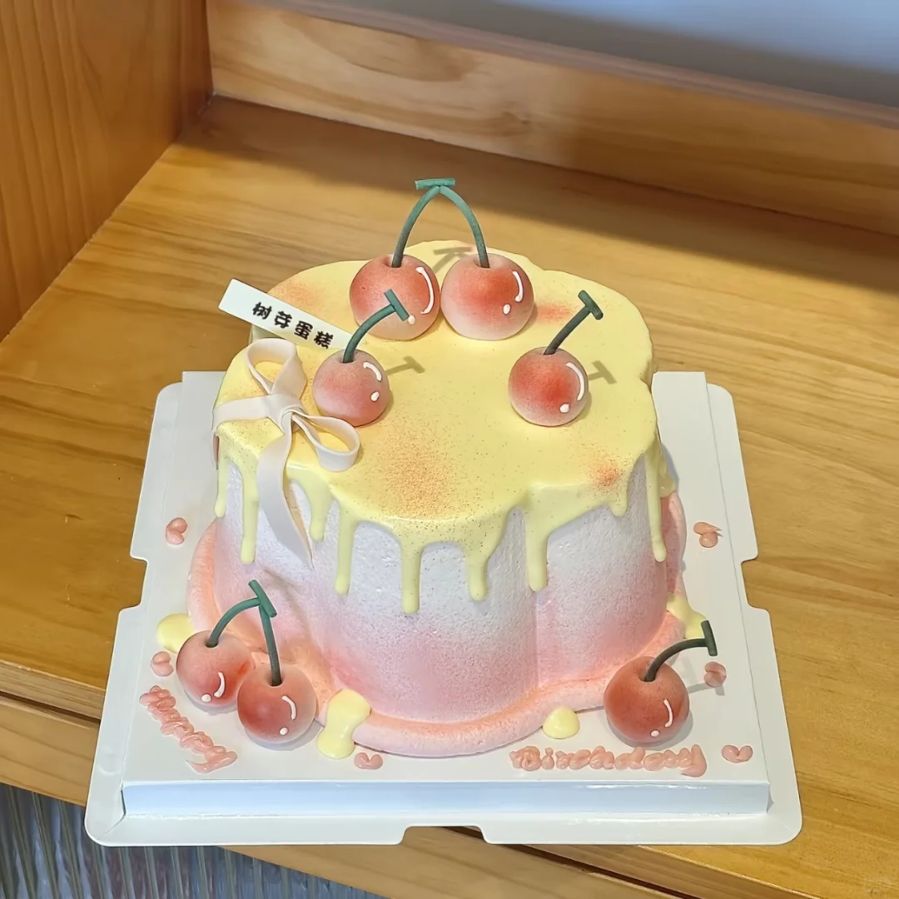
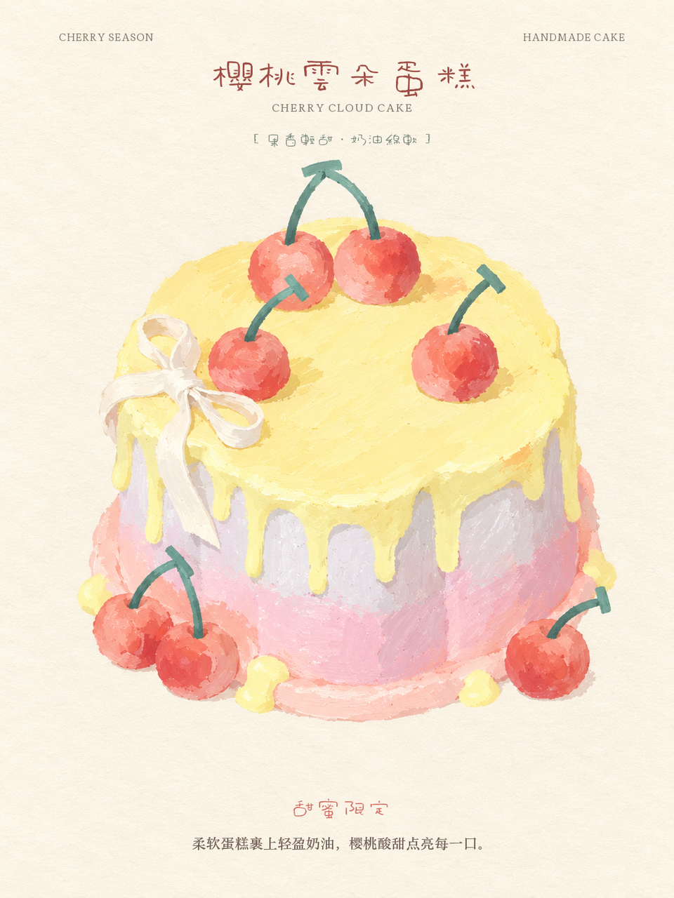

# 水粉风格海报

[下载完整 Skill ZIP](https://github.com/luccilu-77/shuifen-style-poster/releases/download/v1.0.0/shuifen-style-poster.zip) · 含字体、脚本、参考图与示例。也可直接浏览下方说明和仓库中的展开文件。

把一张普通商品照片，变成带有纸张质感、手绘水粉插画和清晰文字的极简海报。

上传照片，告诉它商品名或想表达的主题，就能制作一张适合新品介绍、门店展示或社交分享的竖版海报。不需要提前抠图，也不需要自己设计版式。

## 效果示例

从日常实拍到水粉海报：提取商品主体，去掉杂乱环境，再搭配标题与短文案。

### 烘焙 · 乳酪软包

输入原图：

输出海报：

### 甜品 · 秋柿吐司

输入原图：

输出海报：

### 蛋糕 · 樱桃云朵

输入原图：

输出海报：

以上均为本 Skill 的实际制作示例，示例品名与文案为创作内容。

## 它能做什么

- **照片变水粉插画**：保留商品的主要形状和辨识特征，转为大色块、哑光笔触的手绘效果。
- **清理杂乱背景**：提取核心主体，去掉无关环境，营造干净的纸本画面。
- **搭配文案与字体**：可以使用你提供的标题，也可以根据主体拟写短文案；最终文字由本地字体准确排版，不交给 AI 猜字。
- **生成完整海报**：默认输出 3:4 竖版图片，并支持继续调整标题、字号、主体大小等内容。

适合食品、饮品、甜品、烘焙、果蔬、花枝与静物；不适合写实精修或复杂场景复刻。

## 怎么用

在支持此 Skill 的 Agent 环境中，上传一张主体清晰的照片，然后直接说：

> 用这个 Skill，把这张照片做成水粉风格海报。商品名是「桂花奶茶」，其他文案帮我拟。

也可以补充你想保留的元素、指定字体或参考风格。没有商品名时会暂拟名称；准确配方、价格等信息请自行提供。

### 其他 Agent 也能用吗？

可以迁移，不限于 Codex，但不是把文件放进去就一定能运行。

- **支持 Skill 的 Agent**：把整个文件夹放到该工具指定的 Skill 目录，按其加载方式启用。请保留 `SKILL.md`、`references/`、`assets/` 和 `scripts/`，不要只复制一个文件。
- **不支持 Skill 的 Agent**：把整个文件夹放进项目，让它先阅读 `SKILL.md`，再按其中的流程和引用资源执行，也可以把它作为项目工作流使用。
- **运行条件**：Agent 需要能读取图片和本地文件、调用图像生成工具，并运行 Python 排版脚本；本地需要安装 Pillow。两款示例字体已附在 `assets/fonts/`，无需另外寻找字体文件。迁移后将排版参数中的字体路径指向随包字体，输入和输出路径改成当前机器的实际路径，并将文档中的图像生成调用映射到该 Agent 可用的工具。

可直接给其他 Agent 这段指令：

> 请先完整阅读这个文件夹里的 SKILL.md，并按需读取它引用的文件。检查图像生成工具、Python、Pillow 和字体是否可用，将路径适配到当前环境，再用我上传的照片制作水粉海报。图像工具只生成无字底图，最终文字用本地字体渲染；缺少必要能力时请说明，不要静默改成 AI 生字。

只有聊天、不能生成图像或运行脚本的 Agent，可以协助拟写文案和制作说明，但不能独立完成这套成图流程。不同模型生成的插画效果也可能不同。

## 你会得到

一张完成文字排版的 PNG 海报，以及无字底图、透明文字层和可再次调整的排版参数文件。文字层与参数文件不等同于 PSD 或矢量源文件。

随包附带两款字魂字体，供本工作流的设计交流示例使用，也可指定其他字体文件：

- [字魂自言自画体](assets/fonts/zihunziyanzihuati_T.ttf)：标题、短句与标签。
- [字魂阅宋](assets/fonts/zihunyuesong_T.ttf)：英文与辅助说明。

附带字体文件不代表授予商业使用权。

详细执行规范见 [SKILL.md](SKILL.md)。

## 字体声明

本项目示例使用字魂字体，仅供设计交流使用。商用需要前往字魂官网购买相应授权。

