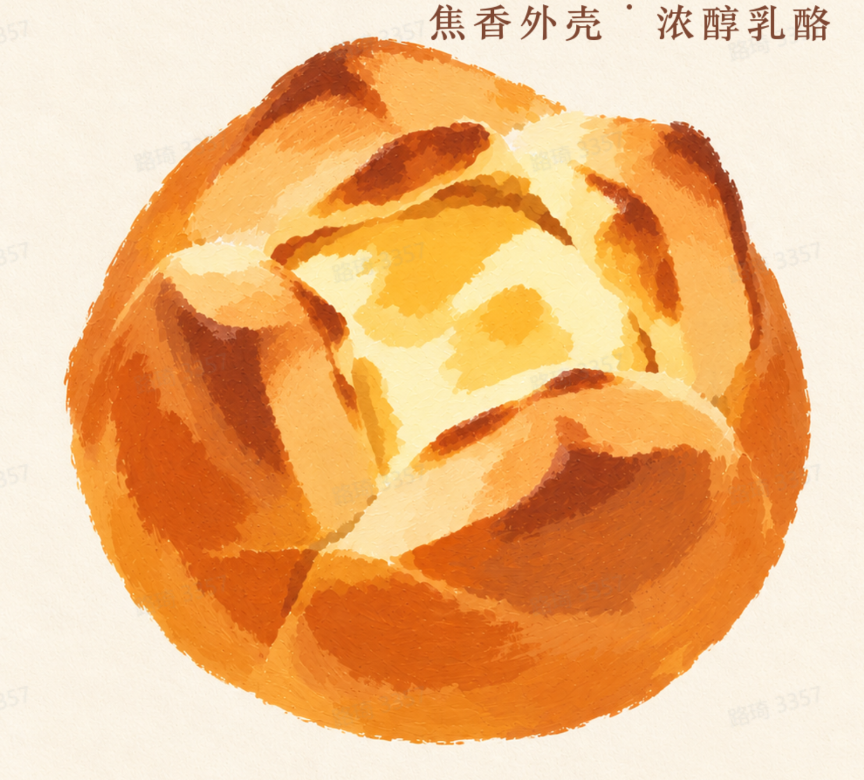

# 水粉抽象强度校准

用户提供的目标强度如下，只作为绘画语言参考：

## 应迁移的特征

- 少量连续的大块不透明哑光色面构成轮廓、外皮与内馅；色块先于笔触被感知。
- 面包参考以明亮金黄、橙色为主体，焦褐部分归并为少数暖赭色形状，而非深黑沟壑；内馅归并为奶油白和淡黄色块。
- 宽笔触、局部干刷与破碎边缘保留手绘感，但细碎笔触只作为色面内部的轻微变化，不制造多层明暗和写实建模。
- 概括原图中的细纹、焦点、孔隙和光泽，去掉白色反光碎点、密集细线、连续渐变及真实投影。

## 使用边界

- 迁移的是色面尺度、色阶简化程度和纹理主次；面包的橙黄配色不强加给饮品、果蔬等其他主体。
- 不复制参考图里的标题、水印、商品外形或放大裁切。当前主体仍由用户原照片决定。
- 修正风格时锁定已确认的构图、主体占比和本地字体排版，避免把水粉调整变成整张重设计。

## 目视验收

1. 缩小预览时应首先看到几块清楚的颜色形状，而非照片细节。
2. 放大后可以看见颜料与纸感，但不能因碎笔、暗部和亮斑重新呈现写实光影。
3. 与此参考比较抽象强度；不要把提示词中的色数当作实际像素色数或自动验收结论。
